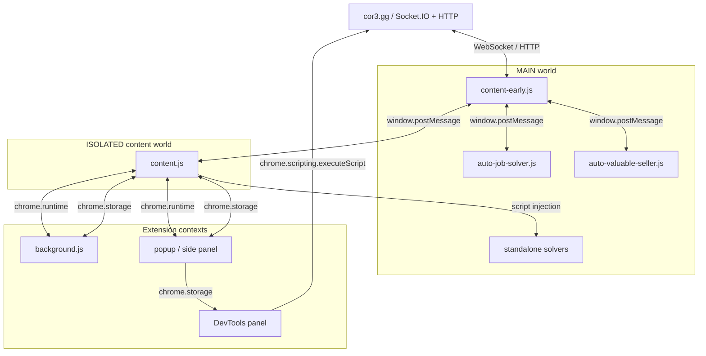
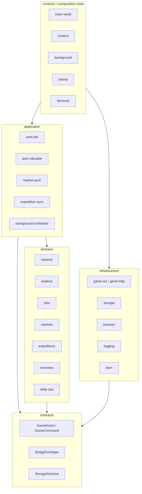

# cor3-helper 2.0 — Architecture Audit & Redesign Proposal

- **Audit baseline:** `experimental` at `c7b69c7` (`v1.8.6-salta-exp.2`)
- **Stable line:** `main` at `v1.8.6-salta.3`
- **Date:** 2026-11-08
- **Scope:** whole repository, all runtime contexts, all user-visible and hidden features
- **Mode:** read-only investigation. This report is the audit artifact.
- **Purpose:** decide what exists, what is wrong, what the 2.0 structure should be, and how to migrate with controlled risk.

> **Historical snapshot (2026-11-08).** This report describes the repository before the 2.0 rewrite. H1, H2, H8 and most M-items have since been implemented on the `v2` branch. Do not treat the findings below as current status; use the [feature inventory](./cor3-helper-2.0-feature-inventory-and-tech-debt.md) and the [H8 design](./cor3-helper-2.0-h8-background-decomposition-design.md) for current state.

> **Revision 2 — Maintainer decisions applied**
>
> The maintainer has now approved the repository strategy, TypeScript, Zod, Preact, token handling, static item catalog, PSU policy, non-max support, legacy-tool policy, and development extension identity.
>
> The authoritative decision register is:
> [`cor3-helper-2.0-architecture-decision-record.md`](./cor3-helper-2.0-architecture-decision-record.md).
>
> Sections 4, 6.12, 9, 11, 13, 15, 17, 18, and 19 below have been updated to match those decisions. Items not confirmed by the maintainer remain marked **Open**.

### Evidence labels used in this report

- **[F] Fact:** confirmed directly from source, manifest, build, or Git state.
- **[I] Inference:** strongly implied by code, but not executed against the live game in this audit.
- **[A] Assumption:** needs game/account/maintainer confirmation.
- **[D] Decision:** a product or architecture choice that needs maintainer approval.

---

## 1. Project overview

### 1.1 One-sentence description

`cor3-helper` is a Chrome MV3 extension that intercepts and emulates parts of the `cor3.gg` Socket.IO game protocol, stores the resulting game state in extension storage, and runs both read-only dashboards and stateful automation on top of that state.

### 1.2 Size and shape

Confirmed from the repository:

```text
JavaScript source files:        104
JavaScript lines:               27,293
JavaScript source size:         1.24 MB
Popup source:                   404 KB
content-early source:           248 KB
content source:                 208 KB
Popup CSS:                      2,828 lines
Popup HTML:                     766 lines
Build entry bundles:            8
```

Largest files:

```text
src/popup/auto-job-solver-ui.js       54,175 bytes
src/popup/markets.js                  47,920
src/content-early/message-listener.js 47,849
src/content-early/market-requests.js  47,158
src/content-early/ws-message-handler.js 35,800
src/popup/loadout.js                  34,266
src/auto-job-solver/solvers.js        33,835
src/content/message-listener.js       33,272
src/standalone/daily-hack-solver.js   32,713
src/content/ws-relay.js               31,857
```

The code is not large by general software standards, but it is dense in implicit contracts, runtime contexts, and duplicated business rules.

### 1.3 Runtime topology

The extension is not one program. It is at least six cooperating programs:

1. **MAIN-world content script (`content-early.js`)** — document-start; intercepts page WebSockets and HTTP.
2. **Isolated content script (`content.js`)** — document-idle; bridges the page world to Chrome APIs and injects DOM automation.
3. **Injected MAIN-world engines** — `auto-job-solver.js`, `auto-valuable-seller.js`.
4. **Injected classic solvers** — decrypt, ICE Wall, simple decrypt, daily hack.
5. **MV3 service worker (`background.js`)** — alarms, scheduling, tab messaging, storage.
6. **Extension UI** — popup/side panel, DevTools panel, offline log viewer.

Each context has a different lifetime, permission model, DOM access, and storage access. This is the single most important architectural constraint.

### 1.4 Overall assessment

The project is a **modular monolith in source form** but an **implicit distributed system at runtime**. The modules are separated by file, not by runtime context or domain contract. Most of the current maintenance cost comes from that gap, not from any single bug.

---

## 2. Complete feature inventory

### 2.1 User-visible, background, and hidden features

| # | Feature | Primary code | Trigger / UI | Shared capabilities | Migration decision |
|---|---|---|---|---|---|
| 1 | Auto Job Solver | `auto-job-solver/*`, `content/message-listener.js`, `popup/auto-job-solver-ui.js` | Popup toggle + start button | jobs, network, loadout, WS gateway, minigame port | Rebuild application, keep job strategies |
| 2 | Auto Finish All Jobs | `background/auto-finish-jobs.js`, `background/index.js` | Popup toggle; `chrome.alarms` | job selection, market state, network map | Rebuild background use case |
| 3 | Auto Valuable Search | `auto-valuable-seller/search-mode.js`, `operations.js` | Valuable Seller panel | network, loadout, server access, market | Rebuild; fix hidden-server enumeration |
| 4 | Auto Valuable Seller | `auto-valuable-seller/seller-mode.js`, `operations.js` | Valuable Seller panel | inventory, loadout, market, network | Rebuild application |
| 5 | Force maintenance batch | `auto-valuable-seller/maintenance.js` | Maintenance tab | server access, loadout, WS | Keep as application use case |
| 6 | Auto Decrypt Hacking | `content/solvers.js`, `standalone/decrypt-solver.js` | Popup toggle | DOM adapter, minigame port | Keep solver, wrap adapter |
| 7 | Auto ICE Wall Hacking | `content/solvers.js`, `standalone/ice-wall-solver.js` | Popup toggle | DOM adapter, WS / minigame | Keep solver, wrap adapter |
| 8 | Auto Simple Decrypt Hacking | `content/solvers.js`, `standalone/simple-decrypt-solver.js` | Popup toggle | DOM adapter | Keep solver, wrap adapter |
| 9 | Auto Daily Hacking | `content/message-listener.js`, `standalone/daily-hack-solver.js` | Daily Ops panel; persistent switch | auth/API, scheduler, DOM solver | Rebuild schedule/use case; keep solver |
| 10 | Market viewer | `popup/markets.js`, `content-early/market-requests.js` | Market cards | market domain, WS/HTTP, network | Rebuild UI + market domain |
| 11 | Market refresh / path-through | `content-early/market-requests.js`, `content/message-listener.js` | Refresh buttons | network router/route executor | Rebuild on network route service |
| 12 | Auto Update Markets | `content/auto-update-markets.js`, `auto-refresh.js` | Popup toggle | market sync, automation queue | Rebuild as application scheduler |
| 13 | Auto refresh job timers | `content/auto-refresh.js`, `popup/auto-refresh.js` | Pinned timer checkboxes | market timers, automation queue | Keep behavior, move to use case |
| 14 | Secret Link/Server Finder | `content-early/network-discovery.js` | Popup toggle / console | discovery, network graph | Merge into Network Discovery |
| 15 | Network Diagnostics | `content-early/network-diagnostics.js` | DevTools console commands | network graph, diagnostics | Keep as infrastructure/diagnostic adapter |
| 16 | Expeditions viewer | `content-early/expeditions.js`, `popup/expeditions.js` | Expeditions panel | expedition domain, WS | Rebuild UI + domain |
| 17 | Mercenary auto expedition | `content/auto-send.js`, `content/ws-relay.js`, `popup/mercenaries.js` | Two switches | expedition, mail, inventory, automation queue | Rebuild as use case/state machine |
| 18 | Mercenary auto decision | `content/auto-choose.js`, `shared/decision-policy.js` | Automatic | decision policy | Keep policy, rehome |
| 19 | Personal Drone auto expedition | `content/drone.js`, `popup/drone.js` | Two switches | expedition/drone, mail, inventory | Rebuild state machine |
| 20 | Drone decision resolution | `content/drone.js` | Automatic | decision policy | Keep policy, rehome |
| 21 | Mailbox auto-claim | `content/mail.js`, `content/ws-relay.js` | Automatic / manual claim | inventory, mail, stash grid | Rebuild domain service + adapter |
| 22 | Inventory viewer | `popup/inventory.js` | Inventory card | inventory domain, stash, specialists | Rebuild UI |
| 23 | Inventory batch sell | `popup/inventory-batch.js`, `content/message-listener.js` | Inventory toolbar | inventory, game commands | Rebuild use case |
| 24 | Warehouse Smart/Compact sort | `content/stash-sort.js`, `popup/inventory-sort.js` | Inventory toolbar | pure grid algorithm, game commands | Keep algorithm, rehome |
| 25 | Loadout viewer | `popup/loadout.js` | Loadout card | loadout domain | Rebuild UI |
| 26 | Automatic loadout resolution | `shared/loadout-resolver.js`, `auto-job-solver/helpers.js`, `auto-valuable-seller/loadout.js` | Automatic | loadout calculator/optimizer | Rebuild domain; keep policy |
| 27 | Pinned timers | `popup/pinned-timers.js` | Header/timer buttons | market/expedition/daily timers | Keep, rehome presentation state |
| 28 | Auto Dismiss Failed Jobs | `popup/auto-job-solver-ui.js`, `content/message-listener.js` | Job UI | job domain, automation queue | Rebuild use case |
| 29 | Market cleanup failed jobs | `popup/markets.js`, `content/message-listener.js` | Market card cleanup button | job domain, market domain | Merge with Auto Dismiss |
| 30 | Version tracking / update check | `popup/version-info.js`, `content-early/http-intercept.js` | Footer | settings, HTTP adapter | Keep as adapter + UI |
| 31 | Helper-Only Mode | `popup/helper-mode.js` | Header toggle | settings, presentation | Keep, formalize settings model |
| 32 | Theme selector | `popup/theme.js`, `popup.css` | Header | presentation | Keep |
| 33 | English / Chinese UI | `popup/i18n.js` | Header language button | presentation | Rebuild with key-based catalog |
| 34 | Popup / side panel / popout | `popup/panel-controls.js`, `manifest.json` | Header buttons | presentation/browser adapter | Keep |
| 35 | Background/fog/notification DOM tweaks | `content/dom-tweaks.js`, `popup/ui-toggles.js` | QoL toggles | DOM adapter | Keep, wrap |
| 36 | Anti-AFK clicker | `content/solvers.js`, `content-early/message-listener.js` | Automatic when automation starts | DOM/browser timer | Keep as infrastructure adapter |
| 37 | Dev TC reachability test | `popup/dev-tcs.js`, `content-early/message-listener.js` | Hidden `#devTcsSection` | network, server access, loadout | Deprecate; do not migrate |
| 38 | DevTools WS inspector | `devtools-panel/*`, `libs/ws-messages.js` | Chrome DevTools panel | logging repository, IDB | Keep, migrate contract/log schema |
| 39 | Offline log viewer | `devtools-log-viewer/*` | Popout page | log export/import | Keep |
| 40 | Console/error logging | `libs/console-logger.js`, `libs/errors.js` | Automatic | logging | Rebuild with redaction and structured events |
| 41 | Initial data fetch / reconnect | `content-early/initial-fetch.js`, `ws-proxy.js` | Page load / WS open | session, market, inventory, loadout | Rebuild as session use case |
| 42 | Service-worker keepalive | `background/index.js` | Every 30s | scheduler/browser adapter | Keep, review necessity |
| 43 | Token-expired recovery | `content-early/ws-message-handler.js`, `ws-proxy.js` | Automatic | auth/session | Rebuild as session policy |
| 44 | Legacy `ws-interceptor.js` | `src/standalone/ws-interceptor.js` | Not injected anywhere found | old WebSocket capture | Deprecate |
| 45 | Static path map | `shared/server-map.js` | Fallback/maintenance checks | network routing | Deprecate after dynamic migration |

### 2.2 Feature status and known limitations

From code and prior test evidence:

- **Network discovery** manual scan: 48/48 IPs, no new edges on the max account, endpoint unchanged. Resume scanning worked from 4/48 to 5/48. Multi-tab lock cannot be tested because a second cor3 tab disrupts the game. **[F/I]**
- **Network discovery auto trigger** exists only for market no-path; Auto Job does not force discovery while it owns the automation queue. **[F]**
- **Background dynamic graph** has synthetic validation; live maintenance-window validation is still missing. **[F/I]**
- **Loadout PSU/verification** appears correct in the latest job log; 19 jobs completed, 1 failed earlier, no `0 equipped software` regression in the attached segment. **[F/I]**
- **Valuable Seller Search** has a concrete enumeration bug: it uses the static `ALL_SERVERS` table instead of `sInfo.serverName` from the map, so hidden-only servers are not scanned. **[F]**
- **Static path map** is still active as fallback in Auto Job, Valuable Seller, Background, and Popup. **[F]**
- **Dev TC** UI is hidden with no visible trigger; it is effectively dormant. **[F]**
- **`src/standalone/ws-interceptor.js`** is built and exposed but not injected; it is legacy dead code. **[F]**

---

## 3. Current directory structure

### 3.1 Repository tree

```text
.
├── build.js
├── manifest.json
├── package.json
├── package-lock.json
├── versions.json
├── README.md
├── CONTRIBUTING.md
├── SECURITY.md
├── LICENSE
├── docs/
│   ├── cor3-ws-events.md
│   └── releases/
├── scripts/
│   └── sync-versions.js
├── .github/
│   ├── workflows/release.yml
│   ├── ISSUE_TEMPLATE/
│   └── PULL_REQUEST_TEMPLATE.md
├── icon/
├── factions/
└── src/
    ├── content-early/
    │   ├── index.js
    │   ├── state.js
    │   ├── ws-proxy.js
    │   ├── ws-send.js
    │   ├── http-intercept.js
    │   ├── ws-message-handler.js
    │   ├── ws-commands.js
    │   ├── message-listener.js
    │   ├── market-requests.js
    │   ├── expeditions.js
    │   ├── drone.js
    │   ├── initial-fetch.js
    │   ├── network-diagnostics.js
    │   └── network-discovery.js
    ├── content/
    │   ├── index.js
    │   ├── helpers.js
    │   ├── ws-relay.js
    │   ├── engine-relay.js
    │   ├── message-listener.js
    │   ├── solvers.js
    │   ├── auto-send.js
    │   ├── auto-choose.js
    │   ├── auto-refresh.js
    │   ├── auto-update-markets.js
    │   ├── mail.js
    │   ├── drone.js
    │   ├── stash-sort.js
    │   ├── dom-tweaks.js
    │   └── log-writers.js
    ├── auto-job-solver/
    │   ├── index.js
    │   ├── state.js
    │   ├── helpers.js
    │   ├── steps.js
    │   ├── solvers.js
    │   └── main-loop.js
    ├── auto-valuable-seller/
    │   ├── index.js
    │   ├── state.js
    │   ├── operations.js
    │   ├── loadout.js
    │   ├── server-access.js
    │   ├── search-mode.js
    │   ├── seller-mode.js
    │   └── maintenance.js
    ├── background/
    │   ├── index.js
    │   ├── helpers.js
    │   └── auto-finish-jobs.js
    ├── popup/
    │   ├── index.js
    │   ├── state.js
    │   ├── constants.js
    │   ├── i18n.js
    │   ├── theme.js
    │   ├── panel-controls.js
    │   ├── timestamps.js
    │   ├── daily-ops.js
    │   ├── dev-tcs.js
    │   ├── expeditions.js
    │   ├── expedition-tabs.js
    │   ├── drone.js
    │   ├── pinned-timers.js
    │   ├── markets.js
    │   ├── market-toggles.js
    │   ├── ui-toggles.js
    │   ├── info-panels.js
    │   ├── inventory.js
    │   ├── inventory-batch.js
    │   ├── inventory-sort.js
    │   ├── loadout.js
    │   ├── mercenaries.js
    │   ├── archived-expeditions.js
    │   ├── auto-job-solver-ui.js
    │   ├── auto-valuable-seller-ui.js
    │   ├── helper-mode.js
    │   ├── version-info.js
    │   ├── refresh-all.js
    │   ├── auto-refresh.js
    │   ├── storage-listeners.js
    │   ├── dom-helpers.js
    │   └── utils.js
    ├── shared/
    │   ├── server-constants.js
    │   ├── server-map.js
    │   ├── loadout-resolver.js
    │   ├── decision-policy.js
    │   ├── hack-utils.js
    │   ├── error-map.js
    │   ├── ws-utils.js
    │   ├── devtools-constants.js
    │   ├── devtools-msg-utils.js
    │   ├── devtools-tree-view.js
    │   └── devtools-detail-search.js
    ├── standalone/
    │   ├── decrypt-solver.js
    │   ├── daily-hack-solver.js
    │   ├── ice-wall-solver.js
    │   ├── simple-decrypt-solver.js
    │   └── ws-interceptor.js
    ├── devtools-panel/
    │   ├── index.js
    │   └── idb-access.js
    ├── devtools-log-viewer/
    │   └── index.js
    ├── libs/
    │   ├── console-logger.js
    │   ├── errors.js
    │   ├── msgpack-codec.js
    │   ├── notepack.min.js
    │   └── ws-messages.js
    └── html/
        ├── popup.html
        ├── popup.css
        ├── devtools.html
        ├── devtools.js
        ├── devtools-panel.html
        └── devtools-log-viewer.html
```

### 3.2 Directory responsibilities

- `content-early/` — MAIN-world protocol layer and global page state. It is the closest thing to a game SDK, but it is also a feature grab bag.
- `content/` — isolated-world bridge, Chrome API adapter, scheduling, DOM automation, mail/drone/stash/expedition state machines.
- `auto-job-solver/` — stateful job execution engine injected into MAIN world.
- `auto-valuable-seller/` — stateful valuable search/sell engine injected into MAIN world.
- `background/` — service-worker scheduler and storage-driven job collector.
- `popup/` — presentation, settings, view rendering, popup-to-content messaging.
- `shared/` — partly domain, partly infrastructure, partly presentation constants. This is the most ambiguous directory.
- `standalone/` — DOM/minigame solvers injected as classic scripts; they cannot use the normal ESM bundle graph.
- `libs/` — classic scripts loaded before bundles; they install global logging and IndexedDB helpers.
- `devtools-panel/`, `devtools-log-viewer/` — diagnostics presentation with a separate IDB access path.

### 3.3 Entry points and build

`build.js` builds eight bundles:

```text
src/auto-job-solver/index.js       -> auto-job-solver.js
src/auto-valuable-seller/index.js  -> auto-valuable-seller.js
src/background/index.js            -> background.js
src/content/index.js               -> content.js
src/content-early/index.js         -> content-early.js
src/popup/index.js                 -> popup.js
src/devtools-panel/index.js        -> devtools-panel.js
src/devtools-log-viewer/index.js   -> devtools-log-viewer.js
```

`esbuild` bundles each entry to an IIFE. There is no code splitting, no source map, no type checking, no lint step, and no test step. Static files are copied verbatim; `manifest.json` is rewritten with package version and fork build suffix.

### 3.4 Manifest and permissions

`manifest_version: 3`. Permissions:

```text
storage, scripting, activeTab, tabs, sidePanel, alarms
```

Host permissions:

```text
cor3.gg, os.cor3.gg, svc-corie.cor3.gg, raw.githubusercontent.com
```

Two content scripts:

- `content-early.js` at `document_start`, `world: MAIN`
- `content.js` at `document_idle`, isolated world

Injected engines and solvers are exposed through `web_accessible_resources` with `<all_urls>`.

### 3.5 Release process

- `package.json` is the canonical extension version and fork build number.
- `build.js` writes `manifest.version` and `manifest.version_name`.
- `.github/workflows/release.yml` runs on `v*` tags, checks `versions.json`, builds, zips `dist`, and creates a GitHub release.
- Experimental tags use `-exp.` and become pre-releases.
- The actual release is a manually loaded unpacked extension, not a Web Store release.

---

## 4. Technology stack and dependencies

### 4.1 2.0 stack

| Area | 2.0 choice | Status | Assessment |
|---|---|---|---|
| Extension platform | Chrome MV3 | Keep | Appropriate |
| Source language | TypeScript strict | **Approved** | All new source is `.ts`/`.tsx`; no new `.js` source |
| Bundler | esbuild | Keep | Bundles TS/TSX to IIFE per runtime context |
| UI | Preact + TypeScript | **Approved** | Componentized popup/side panel/DevTools; no large state framework |
| UI state | Preact Signals or local hooks/store | **Open** | Evaluate bundle size and testability before freezing |
| Game transport | WebSocket/HTTP adapters with typed contracts | Rebuild | Isolate game protocol from domain |
| Storage | Versioned repositories over chrome.storage/localStorage/IndexedDB | Rebuild | One schema/migration layer |
| Scheduling | Clock + Scheduler ports; chrome.alarms for background | Rebuild | Testable, no scattered timers |
| Tests | Vitest + contract/fixture tests; Playwright optional | Add | Must exist before domain migration |
| Type checking | `tsc --noEmit` | Add | Strict flags as approved |
| Runtime validation | Zod at external boundaries | **Approved** | Not inside every internal function |
| Lint/format | ESLint or Biome | **Open** | Pick one; enforce boundaries |
| Dependency | esbuild, TypeScript, Zod, Preact | Add | Remove unused `npm` dependency |

### 4.2 TypeScript

**Decision: Fully adopt TypeScript. Approved.**

Policy:

- All new source files are TypeScript (`.ts`, `.tsx`).
- `strict`
- `noUncheckedIndexedAccess`
- `exactOptionalPropertyTypes`
- `useUnknownInCatchVariables`
- Separate `tsconfig` per runtime context where needed.
- Keep esbuild for bundling; `tsc --noEmit` in CI.
- Existing v1 JavaScript remains only as reference or temporary compatibility code; it is not the pattern for new work.

Consequences:

- Initial setup and migration cost.
- Some game payloads require explicit DTO mapping and Zod schemas.
- AI agents get a much stronger feedback loop.

### 4.3 Runtime validation

**Decision: Adopt Zod. Approved.**

Use Zod only at external boundaries:

- raw WebSocket frames;
- HTTP responses;
- `chrome.storage` reads;
- cross-context bridge messages;
- imported logs and snapshots;
- static item catalog files.

Do not repeat validation inside every domain function. Parse once at the adapter and pass typed values inward. Measure bundle impact; do not add a second validation library.

### 4.4 UI framework

**Decision: Adopt Preact + TypeScript. Approved.**

2.0 is a UI redesign, not a DOM migration. Requirements:

- Components own presentation and user interaction.
- Application/domain logic is outside components.
- Game/storage access goes through typed interfaces, never directly from components.
- Panels are independent and can be tested in isolation.
- Do not add a large state-management framework.
- Evaluate Preact Signals versus local hooks/small stores before freezing the state convention. **Open**

Suggested UI structure:

```text
ui/
├── app/
│   ├── PopupApp.tsx
│   ├── SidePanelApp.tsx
│   └── DevToolsApp.tsx
├── components/
│   ├── panels/
│   ├── controls/
│   └── layout/
├── hooks/
├── stores/           # small, typed, feature-scoped
├── i18n/
└── view-models/
```

UI rules:

- No direct `chrome.*` in a component.
- No direct `window.postMessage` in a component.
- No game command construction in a component.
- Use view models for derived display state.
- Keep Preact out of MAIN-world game engines; it belongs to extension UI contexts.
- Standalone DOM solvers remain infrastructure adapters; they do not use Preact.

### 4.5 Dependency assessment

- `esbuild` — keep.
- `typescript` — add.
- `zod` — add at boundaries.
- `preact` — add for UI.
- `@preact/signals` — **Open**; evaluate, not automatic.
- `vitest` — add for tests.
- `eslint` or `biome` — choose one.
- `dependency-cruiser` — recommended for boundary enforcement.
- `npm` in `dependencies` — remove; unused.

---

## 5. Module dependency analysis

### 5.1 Static import graph

A custom parser over all `src/**/*.js` found:

```text
modules:              104
relative import edges: 272
static cycles:         0
```

Static cycles are currently absent. That is good, but it is not the whole story.

Top fan-in:

```text
20  src/popup/utils.js
13  src/popup/dom-helpers.js
12  src/popup/i18n.js
12  src/popup/state.js
11  src/content/helpers.js
10  src/popup/timestamps.js
 9  src/content-early/ws-send.js
 9  src/shared/server-constants.js
 8  src/content-early/state.js
 8  src/shared/server-map.js
 7  src/auto-valuable-seller/state.js
 7  src/shared/hack-utils.js
 7  src/shared/ws-utils.js
```

Top fan-out:

```text
28  src/popup/index.js
14  src/content/index.js
13  src/content-early/index.js
10  src/popup/refresh-all.js
 9  src/auto-job-solver/main-loop.js
 6  src/auto-job-solver/helpers.js
 6  src/auto-job-solver/solvers.js
 6  src/auto-job-solver/steps.js
 6  src/popup/auto-refresh.js
 6  src/popup/expeditions.js
 6  src/popup/markets.js
```

### 5.2 Runtime context graph



Important implications:

- `content-early` and injected engines share the page's `window`, global variables, and `postMessage` bus.
- `content` and popup/background share `chrome.storage` and `chrome.runtime`.
- There is no single event bus across contexts. Every boundary is a string message with no schema.
- The popup can read data that the content script wrote, but it cannot call the game directly.
- `background` cannot access the DOM and can only ask the content script to act.

### 5.3 Implicit dependencies

The static graph hides many logical dependencies:

- **111 `window.__cor3*` globals.** Examples: `__cor3InitialFetchInProgress`, `__cor3ServerTypeMap`, `__cor3DownloadFolderId`, `__cor3DarkMarketPending`, `__cor3UsolMarketPathThrough`, `__cor3NetworkDiscovery`, `__cor3NetworkDebug`.
- **105 storage key names** found by a conservative scan; 418 `chrome.storage.*` calls.
- **166 postMessage/bridge types** and **54 game actions**.
- **Runtime callbacks**: `setPostUnreachable` is injected after module load to break an import cycle; several modules add and remove `window` listeners in ad-hoc ways.
- **Global state functions** such as `window.__cor3RequestMarket`, `window.__cor3RequestStash`, `window.__cor3AutoJobGetNetworkMap`, and `window.__cor3ValuableSellItems`.

### 5.4 Cross-bundle sharing

Only these modules are imported by more than one bundle:

```text
shared/server-constants.js    -> content-early, background, popup, auto-job, auto-valuable
shared/server-map.js          -> content-early, background, popup, auto-job, auto-valuable
shared/loadout-resolver.js    -> content-early, auto-job, auto-valuable
shared/hack-utils.js          -> auto-job, auto-valuable
shared/ws-utils.js            -> auto-job, auto-valuable
shared/devtools-*             -> devtools panel + log viewer
```

Everything else is bundle-local. That means shared *behavior* often exists as separate implementations, not shared modules.

### 5.5 Duplication hotspots

Confirmed by code search:

1. **Job collection** — popup `collectAllSupportedJobs()` and `collectAllSupportedJobsUnfiltered()` duplicate background `collectJobsBg()`.
2. **Job type lists** — popup, background, and shared constants each have overlapping lists.
3. **Server priority** — `FALLBACK_SERVER_PRIORITY` in `shared/server-map.js`, popup `SERVER_PRIORITY`, and `VALUABLE_SERVER_PATH_LENGTHS`.
4. **Path-through** — market requests, Auto Job steps, Valuable Seller server access, USOL mercenary fetch, and Dev TC each implement a version.
5. **Loadout fetch/apply** — Auto Job helpers, Valuable Seller loadout, and Dev TC each implement equipment sequencing and verification.
6. **Maintenance checks** — `ServerMap`, background, Auto Job, Valuable Seller, popup `findMaintenanceBlocker`.
7. **Transient busy error lists** — `ws-message-handler.js`, `auto-send.js`, and `drone.js` each maintain a list.
8. **Market IDs and market names** — repeated in `content-early/state.js`, `shared/server-constants.js`, popup auto-job UI, popup markets, and DevTools constants.
9. **Server ID maps** — `shared/devtools-constants.js` duplicates a full server table that also exists in `FALLBACK_PATH_MAP`.

### 5.6 Dependency verdict

The static graph is clean enough to refactor, but the runtime graph is the real architecture. The 2.0 design must make the runtime graph explicit before moving files.

---

## 6. Existing architecture problems and technical debt

### 6.1 No explicit runtime-context contracts

`[F]` The bridge protocol is a set of strings such as `COR3_AUTOJOB_CMD`, `COR3_WS_LOADOUT`, and `COR3_VALUABLE_SERVERS_UPDATE`. There is no version, no request ID convention, no reply typing, no schema, and no timeout abstraction shared across contexts.

Impact:

- A typo becomes a silent timeout.
- A payload shape change is invisible until runtime.
- AI agents cannot reliably discover the contract from the code.
- Multiple modules listen for the same event with different assumptions.

### 6.2 God modules and mixed responsibilities

`[F]` The largest modules combine transport, state, business rules, and UI:

- `content-early/ws-message-handler.js` handles token expiry, stash, mail, loadout, mercenaries, expeditions, market, drone, minigame, and auto-job events.
- `content-early/market-requests.js` handles market requests, path-through, endpoint cache, abort state, and UI messages.
- `popup/auto-job-solver-ui.js` handles rendering, job selection, job collection, priority, debug logs, and start/stop.
- `popup/markets.js` handles four market views, loads, info popups, cleanup, path-through, and storage events.
- `popup/loadout.js` handles hardware/software rendering, manual equip, spec display, and overview.

### 6.3 Domain and infrastructure are mixed

`[F]` Examples:

- `shared/loadout-resolver.js` calls `window.__cor3ServerTypeMap` in `getServerTypeName()`.
- `shared/hack-utils.js` queries the DOM.
- `shared/server-map.js` contains a static path table tied to current game IDs.
- `content/mail.js`, `content/drone.js`, and `content/stash-sort.js` call `chrome.storage` directly.
- `auto-job-solver` and `auto-valuable-seller` construct their own `sendCmd`/`waitForEvent` and own `ServerMap`.
- Popup modules talk directly to `chrome.storage` and `chrome.tabs`.

### 6.4 Duplicate business rules

`[F]` The same rule exists in multiple places with subtle differences:

- "Which jobs are supported?"
- "Which server is further?"
- "Is this path in maintenance?"
- "Which loadout is best?"
- "Is this error transient?"
- "Which market is a recent job from?"

This is the largest long-term regression risk.

### 6.5 Static path tables are already incomplete

`[F]` `FALLBACK_PATH_MAP` has explicit paths for 26 servers. The latest captured map had 48 servers, 57 connections, 12 hidden connections, and 47 non-home servers reachable through the full graph. 21 servers had no static path, and 16 were reachable only through hidden edges.

Impact:

- Static fallback is visible-only and incomplete.
- Valuable Seller currently enumerates only static `ALL_SERVERS`, so hidden-only servers are skipped even though the route layer is dynamic.
- Background uses the dynamic graph if `networkMapData` exists, but has no map bootstrap strategy on a fresh profile.
- Popup `findMaintenanceBlocker()` still uses static paths.

### 6.6 Graph routing is more expensive than necessary

`[F]` `ServerMap.findAllPaths()` performs a full DFS enumerating all simple paths, then sorts by length. It caches by target and maintenance fingerprint. For 48 nodes and 57 edges this is acceptable; for a larger/cyclic graph it is exponential and creates unnecessary arrays.

Recommendation:

- BFS/Dijkstra for shortest path and connectivity.
- k-shortest paths only when a route fails.
- Maintenance check as a graph reachability problem, not "enumerate all paths first."
- Cache by graph version + maintenance fingerprint.

### 6.7 Endpoint concurrency is partially protected

`[F]` There is an automation queue in `content/helpers.js`, but it covers only some use cases. Discovery has a separate localStorage lock. Market refresh has several global flags. Auto Job and Valuable Seller have their own caches and runtime state. The game only allows one cor3 tab in practice.

Impact:

- Endpoint-changing operations can race across modules.
- The same state is represented by `automationQueueStatus`, window flags, and storage keys.
- Testing concurrency is difficult because a second tab breaks the game connection.

### 6.8 No typed game data model

`[F]` Raw game objects are passed through almost unchanged. There are variant shapes for mercenaries, drone data, market jobs, stash items, and loadout specs. Optional fields are handled with scattered checks.

Impact:

- UI renderers are full of defensive fallbacks.
- A missing field can become `undefined` in a label or price.
- Data normalization is duplicated.
- Storage contains old shapes indefinitely.

### 6.9 Unversioned persistence

`[F]` There is no schema version for `chrome.storage.local`, `chrome.storage.sync`, `localStorage`, or IndexedDB. Key names are flat and numerous.

Impact:

- Upgrades cannot know whether cached data is compatible.
- Settings migration is ad hoc (for example, only `autoSendMerc` has a legacy-key migration).
- Old cache data can be interpreted by new code.
- Sensitive data such as `bearerToken` is stored in `chrome.storage.local`.

### 6.10 Test and quality infrastructure is absent

`[F]` No test files, no test runner, no linter, no `tsconfig`, no type check, and no CI test step. The release workflow only builds.

Impact:

- Refactoring is judged by manual play sessions.
- AI agents have no fast feedback loop.
- Regressions in path, loadout, and storage migration are likely.
- A 2.0 rewrite cannot be safely validated without adding this first.

### 6.11 UI architecture is monolithic

`[F]` Popup modules directly own DOM references, storage reads, event listeners, render functions, and business decisions. `popup/index.js` imports 28 modules for side effects. i18n uses exact-text matching and a DOM observer, with 12 `data-i18n-*` attributes in the HTML but 476 `t()` calls in JS.

Impact:

- Hard to test without a browser.
- Hard to reuse a panel.
- Hard for AI agents to change one feature without touching others.
- Chinese coverage is partial and fragile.

### 6.12 Security and privacy risks

`[F]` The extension captures the bearer token and raw WebSocket traffic:

- `bearerToken` is stored in `chrome.storage.local`.
- `COR3_BEARER_TOKEN` is posted into the page world.
- `ws-messages.js` stores raw WS messages in IndexedDB; `console-logger.js` stores console arguments.
- DevTools exports can contain those logs.

Impact:

- Tokens and private game data can persist in browser storage and exported logs.
- A compromised page script could observe page-world token messages.
- Logs are not redacted.

**Decision: stop persistent token storage by default. Approved.**

Target policy:

- Token lives in memory/session only.
- The content context mediates authenticated game/API calls.
- Popup/background ask the content auth adapter; they never read a persisted token.
- Reacquire the game session credential after reload/restart.
- All logs, diagnostics, snapshots, and exports redact Authorization/JWT/token fields.
- `chrome.storage.local` must not contain `bearerToken` in 2.0.

This is a breaking data-flow change and must be reflected in the session/auth adapter design.

### 6.13 Build and dependency hygiene

`[F]` `package.json` declares `npm` as a runtime dependency but no code imports it. `npm` is not needed. The build has no typecheck/lint/test stage. `dist` is ignored and manual.

### 6.14 Dead or dormant code

`[F]` Examples:

- `src/standalone/ws-interceptor.js` is copied and exposed but never injected; `content-early` supersedes it.
- `Dev TC` UI has no visible trigger in the current popup (`showDevTcs()` is exported but never called).
- `src/auto-job-solver/main-loop.js` imports `SERVER_PATH_MAP` but does not use it.
- Several popup state fields are not the source of truth and mirror storage.

---

## 7. Domain analysis and recommended boundaries

Do not define 2.0 by the current folder names. Define it by business capability.

| Domain | What it owns | Business rules | External capabilities | Consumers | Independent subsystem? |
|---|---|---|---|---|---|
| Network | Servers, edges, hidden routes, maintenance, endpoint, discovery | reachability, route ranking, maintenance filtering, hidden-edge semantics | get.map, connect.ip, set.endpoint, login/hack | Auto Job, Valuable, Market, Background, Diagnostics | Yes |
| Loadout | Hardware/software catalog, player inventory, specs, resource model | canBoot, ability power, PSU policy, optimization, verification | loadout.get/equip/unequip, inventory snapshot | Auto Job, Valuable, Popup, Dev TC | Yes |
| Jobs | Job offers, requirements, conditions, execution progress, rewards | supported types, priority, stale-job handling, minigame lock | market get.jobs, take, complete, dismiss; SAI commands | Auto Job, Background, Popup | Yes |
| Markets | Market snapshots, lots, prices, sellable items, market routes | reset durations, sell order, market availability, path-through | market get.options/get.jobs/get.lots/sell.items | Valuable, Auto Job, Popup, Background | Yes |
| Expeditions | Mercenary and drone missions, configs, decisions, claims | selection policy, cost/risk, repair thresholds, decision policy | expeditions/drone commands, mailbox | Auto-send, Drone, Popup | Yes |
| Inventory | Stash grid, items, valuations, specialists | placement, rarity order, batch filters, capacity | stash, mail, move.item, sell.item | Mail, Stash sort, Popup, Valuable | Yes |
| Daily Ops | Daily task state, schedule, claim status, puzzle type | reset time, lock, retry, claimed state | daily-claim API, DOM solver | Daily Hacking, Popup | Yes |
| Session / Game connection | Socket lifecycle, auth token, reconnect, room membership | token expiry, retry, request correlation | WebSocket, fetch/XHR | All game-facing features | Infrastructure-ish, but has policy |
| Settings | User preferences, theme, language, helper mode | migration, defaults | chrome.storage.sync | All UI | Supporting domain |
| Diagnostics | Structured logs, snapshots, exports, DevTools | redaction, limits, retention | storage, IndexedDB, DevTools | Developers, support | Supporting service |

### 7.1 Boundary rules

- **Network** does not execute login/hack. It produces a route. Route execution belongs to the application layer because it mutates game state and needs loadout/access.
- **Loadout** does not call `loadout.get` or `equip`; it produces a plan. Applying and verifying belongs to an application port.
- **Jobs** does not own market fetching. It consumes a market snapshot and produces job actions.
- **Market** does not own network routing. It asks network for a route.
- **Expeditions** does not own mail or stash. It emits claim requests and consumes inventory events.
- **Inventory** owns the grid model and placement algorithm; it does not own DOM or browser storage.
- **Daily Ops** owns schedule/claim state; the puzzle solver is a DOM adapter.

### 7.2 What should not become a giant `shared/`

`shared/` currently contains:

- game IDs and constants;
- graph and path tables;
- loadout math;
- DOM selectors;
- WS utilities;
- DevTools helpers;
- error mapping.

In 2.0:

- IDs and DTO contracts go to `contracts/`.
- Domain logic goes to `domains/*`.
- Infrastructure adapters go to `infrastructure/*`.
- UI helpers go to `ui/*`.
- Only `kernel/` and `contracts/` are globally shared.

---

## 8. 2.0 target architecture

### 8.1 Recommended style

**Domain-Oriented Hexagonal Architecture with Explicit Runtime Contexts.**

This is a layered architecture inside each domain, plus a context architecture around the whole extension. It is not a pure four-layer stack.

Why:

- A pure layer diagram would put `content-early`, `content`, `background`, and popup into one "presentation" or "infrastructure" bucket, hiding the actual hard problem: four separate JavaScript runtimes.
- A pure DDD monolith would put browser and game APIs into domain services, recreating the current coupling.
- Hexagonal ports/adapters lets the domain stay pure and lets each runtime context provide its own adapters.
- The runtime context boundary is the primary architectural boundary; the domain boundary is the second.

### 8.2 Target module tree

```text
src/
├── kernel/                    # Result, errors, IDs, Clock, event contract primitives
├── contracts/                 # bridge envelopes, game DTOs, storage schemas, API contracts
├── domains/
│   ├── network/               # graph, route planner, discovery, maintenance
│   ├── loadout/               # catalog, inventory model, calculator, optimizer
│   ├── jobs/                  # job model, requirements, selection, execution policies
│   ├── markets/               # market model, sell order, market availability
│   ├── expeditions/           # mercenary/drone model, selection, decisions
│   ├── inventory/             # stash grid, placement, valuation
│   └── daily-ops/             # daily state and schedule
├── application/
│   ├── auto-job/
│   ├── auto-valuable/
│   ├── market-sync/
│   ├── expedition-sync/
│   ├── stash-sort/
│   ├── daily-hack/
│   └── background-scheduler/
├── infrastructure/
│   ├── game-ws/               # WebSocket proxy, Socket.IO framing, command gateway
│   ├── game-http/             # fetch/XHR intercepts, version capture
│   ├── browser/               # tabs, alarms, side panel, extension APIs
│   ├── storage/               # chrome.storage, localStorage, IndexedDB repositories
│   ├── logging/               # structured logs, redaction, retention
│   ├── dom/                   # minigame/DOM automation adapters
│   └── time/                  # Clock, delays, scheduler
├── contexts/
│   ├── main-world/            # composition root for content-early + injected engines
│   ├── content/               # composition root for isolated content script
│   ├── background/            # composition root for service worker
│   ├── popup/                 # composition root for popup/side panel
│   └── devtools/              # composition root for DevTools
├── ui/                        # Preact + TypeScript (approved)
│   ├── app/                   # PopupApp, SidePanelApp, DevToolsApp
│   ├── components/
│   │   ├── panels/
│   │   ├── controls/
│   │   └── layout/
│   ├── hooks/
│   ├── stores/                # small typed feature-scoped stores
│   ├── i18n/
│   └── view-models/
└── standalone/                # classic DOM solver adapters (legacy only if retained)
```

### 8.3 Runtime context responsibilities



### 8.4 Why not a single Event Bus

A global event bus would make ordering, lifecycle, and ownership invisible. Use:

- **Typed local event bus** inside a context/application when a domain event has multiple local consumers.
- **Explicit bridge gateway** across contexts with request/response correlation.
- **No global `window` event bus** beyond the bridge adapter.
- **No service locator**.

### 8.5 Composition roots

Each context should have one composition root that wires concrete adapters to application use cases:

```ts
const game = createMainWorldGameGateway({ ws, http, logger });
const network = createNetworkService({ mapSource: game.mapSource, clock });
const loadout = createLoadoutService({ loadoutSource: game.loadoutSource });
const autoJob = createAutoJobUseCase({ game, network, loadout, logger, clock });
```

No container is required. Manual injection is enough and is easier for AI agents to trace.

---

## 9. Layers, dependency rules, and patterns

### 9.1 Layer table

| Layer | May import | Must not import | Examples |
|---|---|---|---|
| Presentation | application ports, view models, UI primitives | concrete game/storage adapters | popup panels, DevTools UI |
| Application | domain, contracts, ports | DOM, `chrome.*`, concrete WS | Auto Job, Valuable Seller, Market sync |
| Domain | kernel, contracts | browser, DOM, game, storage | graph, optimizer, job model |
| Infrastructure | contracts, kernel, external APIs | application/UI | WS gateway, storage repo, logger |
| Contexts | all of the above | — (composition roots only) | main-world, content, background |
| Kernel/contracts | external type libs only | all higher layers | `Result`, envelope, IDs |

### 9.2 Dependency rules

1. Domain must not import `chrome`, `window`, `document`, `WebSocket`, `fetch`, or IndexedDB.
2. Application must not import concrete infrastructure; it receives ports.
3. Presentation must not contain business rules; it renders view models and calls application ports.
4. Contexts may import concrete adapters; they are the only places allowed to know about browser APIs.
5. `contracts/` may be imported everywhere; it must not import domains.
6. No deep imports across domains; each domain exposes a public `index.ts`.
7. No runtime global state outside a context-owned store.
8. No direct `window.postMessage` outside the bridge adapter.
9. No raw game DTO in domain models; map at the adapter boundary.

Enforce with `dependency-cruiser` or ESLint import rules in CI.

### 9.3 Patterns worth using

| Pattern | Use it? | Reason |
|---|---|---|
| Repository | Yes | Storage, snapshots, logs need a stable interface and migration tests |
| Adapter | Yes | Game WS/HTTP, DOM, browser APIs vary by context |
| Manual DI / composition root | Yes | Simple, traceable, testable |
| Strategy | Yes | Job types, decision policy, discovery policies |
| State machine | Yes | Expeditions, drone, mailbox, automation queue |
| Typed local event bus | Yes, per context | Domain events with explicit subscriptions |
| Global event bus | No | Hidden dependencies |
| Generic service locator | No | Hard for AI and tests |
| Full DDD aggregates everywhere | No | Too heavy for this size |
| CQRS / event sourcing | No | Not justified |
| Preact + TSX | **Yes, approved** | UI redesign; keep business logic outside components |
| Large global state library | No | Prefer feature-scoped stores; Signals/hooks still open |

### 9.4 Bridge contract

Every cross-context message should use one envelope:

```ts
type BridgeEnvelope<T> = {
  version: 1;
  id: string;
  source: ContextName;
  target: ContextName;
  type: string;
  payload: T;
  replyTo?: string;
  timeoutMs?: number;
};
```

Rules:

- Every request has an `id`; every reply references `replyTo`.
- Every boundary validates the payload with Zod.
- Unknown types are logged, not silently ignored.
- Commands and events are separate unions.
- Timeouts and aborts are part of the contract, not ad hoc `setTimeout` calls.
- No raw action strings in application/domain code.

### 9.5 Storage contract

```ts
type StorageEnvelope<T> = {
  schemaVersion: number;
  writtenAt: number;
  data: T;
};
```

Repositories:

```text
SettingsRepository  -> chrome.storage.sync
CacheRepository     -> chrome.storage.local, TTL + schemaVersion
SnapshotRepository  -> chrome.storage.local, versioned snapshots
LogRepository       -> IndexedDB, retention + redaction
SecretStore         -> in-memory/session only, never persistent by default
```

Migrations run once per schema version and are idempotent.

### 9.6 Result and error policy

- Expected business failures return `Result<T, DomainError>`.
- Unexpected failures throw.
- Domain errors use stable codes such as `NETWORK_NO_ROUTE`, `LOADOUT_NO_FEASIBLE_PLAN`, `JOB_MINIGAME_LOCKED`.
- Game error strings are mapped in the infrastructure adapter, not in domain code.
- UI translates error codes with i18n keys, not by matching raw game messages.

---

## 10. Network System design

### 10.1 Current state

`[F]` Current pieces:

- `shared/server-map.js` — mutable graph, DFS path enumeration, maintenance check, fallback path table.
- `content-early/market-requests.js` — map fetch, path-through, unreachable cache.
- `content-early/network-diagnostics.js` — snapshots and diffs.
- `content-early/network-discovery.js` — resumable `connect.ip` scan.
- `auto-valuable-seller/server-access.js` — its own graph and endpoint path-through.
- `background/auto-finish-jobs.js` — persisted full map and maintenance overlay.
- `content-early/message-listener.js` — another graph consumer.

### 10.2 Target model

```ts
type ServerId = string & { readonly __brand: 'ServerId' };
type EdgeId = string & { readonly __brand: 'EdgeId' };

interface Server {
  id: ServerId;
  name: string;
  ip: string | null;
  typeName: string | null;
  cluster: string | null;
  faction: string | null;
  maintenance: MaintenanceState;
  access: AccessState;
  endpointCapable: boolean;
  reachableNow: boolean;
}

interface Edge {
  id: EdgeId;
  a: ServerId;
  b: ServerId;
  hidden: boolean;
}

interface NetworkSnapshot {
  version: number;
  capturedAt: number;
  homeId: ServerId;
  endpointId: ServerId | null;
  servers: ReadonlyMap<ServerId, Server>;
  edges: readonly Edge[];
  maintenanceFingerprint: string;
}
```

### 10.3 Services

| Service | Responsibility |
|---|---|
| `NetworkMapSource` | Port for `get.map` / map events; returns a snapshot |
| `NetworkGraph` | Immutable adjacency, home/endpoint, maintenance lookup |
| `NetworkRouter` | Shortest path, k-shortest, maintenance-aware reachability |
| `NetworkDiscoveryService` | Resumable IP scan, lock, merge, progress |
| `NetworkSnapshotStore` | Persisted full map, version, timestamp, migration |
| `EndpointLease` | Single owner for endpoint-changing operations |
| `NetworkDiagnostics` | Snapshots, diffs, export, redaction |
| `RoutePlanner` | Chooses candidate routes and returns a plan |
| `RouteExecutor` | Application-level execution of login/hack/set endpoint |

### 10.4 Router algorithm

Recommendation:

- BFS for shortest route and reachability.
- Dijkstra if edge cost includes hidden/risk/maintenance.
- Dijkstra/BFS first; only compute k-shortest alternatives when the first route fails.
- `checkPathMaintenance` uses reachability with maintenance nodes removed; no "enumerate all paths" step.
- Cache by `graphVersion + maintenanceFingerprint`.
- Never cache across a map update.
- Return a typed `RoutePlan` with `nodes`, `edges`, `hiddenEdgeCount`, `maintenanceFree`, `blocker`.

Why:

- Current DFS enumerates all simple paths; on a dense or cyclic graph this grows exponentially.
- Current code sorts all paths just to pick the shortest.
- Current `getServerPriority()` computes shortest paths for every server; a single BFS/Dijkstra per target or one all-pairs run can be cheaper.

### 10.5 Discovery

- Keep resumable scan state with a schema version.
- Lock is per-account/per-tab; use a repository, not raw localStorage.
- Scan known IPs; merge new servers/edges; never assume all hidden edges are discoverable.
- Discovery is an application command, not a domain rule.
- Discovery must acquire the same endpoint lease as automation.
- On task completion, request a fresh map; do not force a scan.
- Diagnostics must capture before/after map and endpoint.

### 10.6 Endpoint ownership

`EndpointLease` is the single source of truth:

```text
acquire(owner, reason) -> lease | busy
renew(lease)
release(lease)
```

All operations that call `set.endpoint`, path-through, `connect.ip`, or market server login acquire a lease. This replaces:

- `automationQueueStatus`
- `window.__cor3DarkMarketPending`
- `window.__cor3UsolMarketPathThrough`
- localStorage discovery lock
- ad hoc `_inProgress` flags

### 10.7 Migration from today

1. Introduce `NetworkGraph`/`Router` as a pure package with captured-map tests.
2. Run it in shadow mode next to `ServerMap`; compare shortest paths and maintenance decisions.
3. Migrate Market path-through first.
4. Migrate Auto Job and Valuable Seller.
5. Migrate Background.
6. Remove static path table only after all consumers use dynamic graph + persisted map bootstrap.

### 10.8 Open questions

- `[A]` Are all hidden edges permanently discoverable for a max account, or are some task-gated?
- `[A]` Does `get.map` always include all known edges, or only currently reachable ones?
- `[D]` What should happen when no full map is available on a fresh profile?
- `[D]` Is a 5-minute discovery budget enough on slow connections?

---

## 11. Loadout System design

### 11.1 Current state

`[F]` Current pieces:

- `shared/loadout-resolver.js` — pure-ish analysis/optimizer, but `getServerTypeName()` reads `window.__cor3ServerTypeMap`.
- `auto-job-solver/helpers.js` — fetch/apply/verify and HACK/DECRYPT orchestration.
- `auto-valuable-seller/loadout.js` — another fetch/apply/verify and HACK/SEARCH orchestration.
- `content-early/message-listener.js` — Dev TC loadout logic.
- `popup/loadout.js` — rendering and manual equip.
- Static catalog: none; the runtime `loadout.get` response is the only item source.

### 11.2 Target model

```ts
interface ItemCatalog {
  version: string;
  hardware: HardwareDefinition[];
  software: SoftwareDefinition[];
}

interface InventorySnapshot {
  ownedHardwareIds: ReadonlySet<HardwareId>;
  ownedSoftwareIds: ReadonlySet<SoftwareId>;
  equippedHardwareIdBySlot: Record<HardwareSlot, HardwareId>;
  equippedSoftwareIds: readonly SoftwareId[];
  capturedAt: number;
}

interface LoadoutPlan {
  software: SoftwareDefinition;
  hardware: HardwareSet;
  power: number;
  requiredPower: number;
  sufficient: boolean;
  switchCost: number;
  currentPlan: boolean;
}
```

### 11.3 Components

| Component | Responsibility |
|---|---|
| `ItemCatalog` | Static base data for all obtainable hardware/software |
| `InventoryTracker` | Player-owned/equipped snapshot from game |
| `LoadoutCalculator` | Supply/demand, bootability, ability power |
| `LoadoutOptimizer` | Candidate software × hardware search, scoring, pruning |
| `LoadoutResolver` | Chooses the plan for a target (HACK/DECRYPT/SEARCH) |
| `PsuSelectionPolicy` | Pluggable PSU choice; default MaxPower; policy ID/version in cache key |
| `LoadoutApplier` | Application port: equip/unequip, wait, verify, retry |
| `LoadoutCache` | Inventory/catalog fingerprint cache |
| `LoadoutValidator` | Confirms target software/hardware is actually equipped |

### 11.4 What is static vs dynamic

- **Static:** item definitions and base specs; do not store “best loadout” as static data.
- **Dynamic:** player's owned items, equipped items, current hardware, modifications.
- **Derived:** candidates, analysis, optimal plan.

This is exactly the right split: static catalog + dynamic inventory → candidate plans.

### 11.5 Algorithm

Current exhaustive search is acceptable as a first implementation, but it should be structured:

1. Filter software by target type (HACK server type / DECRYPT file extension / SEARCH server type).
2. For each software candidate, build hardware candidates:
   - CPU × GPU × PSU × RAM.
   - Skip PSUs below CPU+GPU consumption.
   - Skip combinations that cannot boot.
3. Compute `analysis`.
4. Score target ability power.
5. Prefer:
   - sufficient power before raw power;
   - current software;
   - lower switch cost;
   - higher PSU power / protection as tie-break.
6. Cache analysis by `(catalogVersion, inventoryFingerprint, softwareIds, target)`.

Do we need DP/ILP?

- **No, not initially.** The item counts are small and the exhaustive space is CPU × GPU × PSU × RAM. The current code is already logically exhaustive; the problem is repeated deep clones and repeated calculations, not asymptotic complexity.
- Add a Pareto front over resource supply and a branch-and-bound only if measured candidate counts explode.
- Precompute hardware feasibility and avoid `JSON.parse(JSON.stringify(loadout))` per combination.

### 11.6 PSU selection policy

**Decision: maximum `psuPower` is the default, but it must be an extensible policy. Approved.**

The optimizer must not contain a hardcoded `psuPower` comparison. Define a policy interface:

```ts
interface PsuSelectionPolicy {
  id: string;
  version: number;
  score(candidate: HardwareSet, context: LoadoutContext): number;
  tieBreak(a: HardwareSet, b: HardwareSet, context: LoadoutContext): number;
}

class MaxPowerPsuPolicy implements PsuSelectionPolicy { ... }
```

Current default:

```text
1. prefer the maximum psuPower that still boot
2. then higher psuProtection
3. then current hardware
```

Future policies can be added without changing the optimizer:

- protection-focused;
- efficiency-focused;
- switching-cost-focused;
- task-specific power reserve;
- other hardware constraints.

Policy ID and version are part of the loadout cache key.

### 11.7 Cache

Cache key must include:

```text
catalogVersion
inventoryFingerprint
equipped IDs (or inventory version)
ability type + target
policy version (PSU preference, current-plan preference)
```

Invalidate on:

- `COR3_WS_LOADOUT` event,
- inventory change,
- catalog update,
- policy change.

Do not use time-only TTL as the primary key; time-only caches caused the previous `0 equipped software` class of bugs.

### 11.8 Static catalog

**Decision: generate a versioned static catalog from the maintainer's maxed account; keep player inventory dynamic. Approved.**

Three-layer separation is mandatory:

1. **Static Item Catalog**
   - all known hardware/software base definitions;
   - item ID, category, specs, consumption, abilities, server/file applicability;
   - no owner, equipped, or “best plan” data;
   - versioned and maintained by the developer.
2. **Dynamic Player Inventory**
   - fetched at runtime from the game;
   - owned IDs, equipped IDs, current hardware;
   - may differ per player.
3. **Derived Loadout Plans**
   - generated from catalog × player inventory;
   - only owned items are candidates;
   - recomputed when inventory or catalog version changes;
   - never baked back into the static catalog.

Catalog extraction requirements:

- a reproducible extraction script;
- Zod validation of every catalog record;
- uniqueness constraints on item IDs;
- numeric range checks for power, consumption, and slots;
- server/file type reference checks;
- explicit `catalogVersion` and `gameVersion` fields;
- a generated manifest with checksum;
- a diff report between catalog versions.

Compatibility:

- `catalogVersion` and `gameVersion` are separate.
- The optimizer refuses unknown catalog versions unless a compatibility policy allows them.
- A game patch that adds items does not invalidate existing inventory; it creates a new catalog version.
- The catalog is data, not code; loading it is a boundary operation and must be Zod-validated.

Licensing/re-distribution:

- **Open:** determine whether the captured item data may be published in the repository.
- Do not assume account access equals redistribution rights.
- If redistribution is not permitted, keep the generated catalog local/private and ship only a build-time artifact with documented provenance.
- Record the source, capture date, account type, game patch, and extraction script version.

### 11.9 Applier and validator

- Application use case, not domain.
- Sequence hardware changes to avoid PSU rejection; the current Valuable Seller code already has a good “PSU upgrade first” rule.
- After apply, re-fetch and verify.
- Retry once, then return a typed `LoadoutApplyError`.
- Never trust the cached loadout after a change.

### 11.10 Migration

1. Move pure calculator/optimizer into `domains/loadout`, remove `window` access.
2. Add catalog fixture and unit tests.
3. Shadow-compare new optimizer plans against current code.
4. Migrate Auto Job first.
5. Migrate Valuable Seller.
6. Migrate popup display; do not migrate Dev TC.
7. Remove duplicated fetch/apply functions.

### 11.11 Decisions and open questions

Approved:

- Static catalog from max account; player inventory dynamic.
- Non-max accounts are mandatory; no plan may assume complete inventory.
- Maximum `psuPower` is the default PSU selection policy.
- PSU policy must be an extensible strategy interface, not hardcoded in the optimizer.
- Impossible loadouts must return an explicit infeasible/error state, not silently fall back to an assumed full inventory.

Open:

- Static catalog redistribution/licensing. This is a legal/product decision, not a code decision.
- Whether `psuProtection` ever affects game mechanics.
- Item ID stability across patches.
- Exact candidate counts on max and non-max inventories; this determines whether exhaustive search remains acceptable.
- Whether a future policy should optimize switching cost or efficiency instead of only power.
- How catalog extraction is performed without violating game terms or exposing account credentials.

---

## 12. Other domain subsystems

### 12.1 Jobs

Model:

```text
JobOffer, JobRequirements, JobCondition, JobExecution, JobResult
```

Rules:

- supported job type registry;
- server and job priority;
- stale job handling;
- minigame lock and ICE Wall recovery;
- deposit/reward accounting;
- background eligibility.

Design:

- `JobSelector` pure; `JobExecutor` application; `JobTypeHandler` strategy per job.
- Remove job collection duplication between popup and background.
- Keep one supported-type registry.

### 12.2 Markets

Model:

```text
MarketSnapshot, MarketJob, MarketLot, MarketAvailability, SellOrder
```

Rules:

- reset durations;
- market server reachability;
- sell order USOL → SOYUZ → D4RK → HOME;
- lot/job filtering.

Design:

- `MarketService` application use case;
- network route planner injected;
- no market logic inside UI;
- market snapshots normalized and versioned.

### 12.3 Expeditions

Model:

```text
Mercenary, Expedition, ExpeditionConfig, DroneMission, Decision
```

Rules:

- mercenary selection: elite USOL > normal USOL > normal CORE/HOME, cost ascending, risk ascending;
- drone mission: lowest battery, lowest risk, shortest duration;
- aggressive decision policy;
- repair thresholds;
- launch/claim/mail flow;
- transient busy retry.

Design:

- separate `MercenaryAutomation` and `DroneAutomation` use cases;
- explicit state machines;
- pure `DecisionPolicy` already exists and should move to domain;
- mail/stash are ports.

### 12.4 Inventory

Model:

```text
StashGrid, InventoryItem, Placement, StashSortPlan
```

Rules:

- 12-wide grid;
- rarity order;
- smart/compact layout;
- rotation constraints;
- capacity;
- batch sell filters.

Design:

- pure `StashSorter` domain algorithm;
- `StashRepository` and `InventoryCommandPort`;
- UI view model only.

### 12.5 Daily Ops

Model:

```text
DailyTask, DailySchedule, DailyRunResult
```

Rules:

- next reset;
- claimed state;
- single run lock;
- retry on failure;
- English/Chinese puzzle type detection.

Design:

- application scheduler with Clock port;
- DOM solver adapter;
- diagnostics as events, not console strings.

### 12.6 Session, auth, and settings

- Session owns socket lifecycle, token refresh, reconnect, rooms.
- Token should not be persisted by default; keep it in memory/session and expose only auth requests through an adapter.
- Settings require schema version, defaults, and migration.
- Diagnostics require redaction.

---

## 13. Repository and Git migration strategy

### 13.1 Options

| Criterion | A: Refactor in place | B: Long-lived 2.0 branch | C: New 2.0 repository |
|---|---|---|---|
| Architecture freedom | Low–medium | High | Highest |
| Migration cost | Low initially, high churn | Medium | High |
| Maintenance cost | High during transition | Medium | High (dual repo) |
| Git history | Preserved | Preserved | Can be preserved by cloning, but a fresh repo loses continuity unless deliberately imported |
| Issues / releases / CI | Preserved | Preserved | Must be migrated or duplicated |
| Upstream sync | Easy | Easy | Requires an extra remote and manual sync |
| Feature compatibility | Easy to compare | Easy | Harder |
| Release process | Risk of mixing stable and rewrite | Can keep stable releases | Separate pipeline |
| AI agent convenience | One repo, but noisy | One repo, clear branch | Clean, but two sources of truth |
| Rollback | Hard | Easy | Easy |

### 13.2 Decision

**Option B: a long-lived `2.0` branch in the same repository. Approved by the maintainer.**

The project remains a downstream fork of the original project, but 2.0 is an independent architecture design and original rewrite. It is not an official upstream version.

Reasons:

- It preserves Git history, tags, issues, release workflow, upstream remote, and the fork identity.
- It allows stable hotfixes on `main` while 2.0 is developed.
- It makes feature parity comparisons easy because both versions share history and fixtures.
- It avoids a second repository's operational overhead.
- A new repository is justified only if 2.0 becomes an independent product with a different release identity.

Proposed branch policy:

```text
main                  stable fork releases
experimental          current v1.x experimental release line
2.0                   rewrite branch, not released until parity
```

- Branch from `experimental` because it contains the latest network work.
- Freeze non-critical feature work on `experimental`; cherry-pick critical fixes only.
- Use tags such as `v2.0.0-salta.1` when ready.
- Do not rewrite old tags or history.

### 13.3 If Option C were chosen (not approved)

This section is retained only as an alternative analysis. Option B is approved.

Requirements:

- Create the new repo from a clone if history is to be preserved; otherwise document the loss.
- Keep the old repo public and frozen as the reference.
- Recreate CI, release workflow, issue templates, and release notes.
- Use a different extension display name and possibly a different key/ID for side-by-side installation.
- Maintain an explicit upstream sync procedure.
- Do not delete the old repository.

### 13.4 Development extension identity

**Decision: use a separate extension display name and Extension ID during development. Approved.**

Recommended development identity:

```text
Name: cor3-helper 2.0 Dev
manifest.version: 2.0.0
version_name: 2.0.0-salta-dev.N
Extension key: dedicated development key (stable ID)
```

Implementation:

- Build profiles generate different manifest fields: `dev` vs `release`.
- The dev build uses a dedicated `key` so its unpacked ID is stable across reloads.
- The dev build uses separate storage keys/namespaces so it does not overwrite v1 settings.
- The release build keeps its final identity undecided until stable release. **Open**
- The release workflow must not accidentally publish a dev manifest.
- `versions.json` / update checks must not point the dev build at the stable release channel.

Final identity is **Open**:

- same name/ID as v1 for a seamless upgrade;
- or a distinct 2.0 identity for side-by-side installation;
- or a transition release that migrates settings and then retires the v1 ID.

### 13.5 Side-by-side validation

Because only one cor3 tab works at a time, stable and 2.0 cannot run the same automation concurrently on one account.

Recommended:

- Use separate browser profiles.
- Run stable and 2.0 sequentially against the same scenario.
- Save normalized fixtures: map snapshot, loadout plan, job selection, path plan, market snapshot, logs.
- Compare with a small report script.
- Never point both versions at the same live tab at the same time.
- The dev extension uses a separate ID and storage namespace, so its cache/settings do not contaminate v1.

---

## 14. Feature migration matrix

Classification meanings:

- **Keep** — reuse mostly as-is, behind an adapter.
- **Re-home** — move into the new architecture with minor change.
- **Rebuild** — reimplement because current code is too coupled or duplicated.
- **Merge** — fold into another feature.
- **Defer** — keep out of 2.0 initially.
- **Deprecate** — remove.

| Feature | Class | Target owner | Reason / risk |
|---|---|---|---|
| Auto Job Solver | Rebuild | application/auto-job + domains/jobs | Core feature; high parity risk |
| Auto Finish All Jobs | Rebuild | application/background-scheduler | Duplicates job selection; needs map/scheduler |
| Auto Valuable Search | Rebuild | application/auto-valuable | Hidden-server enumeration bug |
| Auto Valuable Seller | Rebuild | application/auto-valuable | Depends on loadout, market, network |
| Force maintenance batch | Keep/Re-home | application/auto-valuable | Small but endpoint-heavy |
| Auto Decrypt Hacking | Keep + adapter | infrastructure/dom | DOM selector churn |
| Auto ICE Wall Hacking | Keep + adapter | infrastructure/dom | Complex solver; high risk to rewrite |
| Auto Simple Decrypt | Keep + adapter | infrastructure/dom | Small |
| Auto Daily Hacking | Rebuild schedule | application/daily-hack | Keep solver; scheduler needs tests |
| Market viewer | Rebuild | ui + domains/markets | Direct DOM monolith |
| Market refresh / path-through | Rebuild | application/market-sync | Network coupling |
| Auto Update Markets | Rebuild | application/market-sync | Automation queue overlap |
| Auto refresh job timers | Re-home | application/market-sync | Small |
| Secret Finder | Merge | domains/network/discovery | Replace legacy scan |
| Network Diagnostics | Keep | infrastructure/diagnostics | Already useful |
| Expeditions viewer | Rebuild | ui + domains/expeditions | Raw data shapes |
| Mercenary auto expedition | Rebuild | application/expedition-sync | State machine + mail + stash |
| Merc auto decisions | Keep | domains/expeditions | Pure policy |
| Drone auto expedition | Rebuild | application/expedition-sync | State machine |
| Drone decisions | Keep | domains/expeditions | Pure policy |
| Mailbox auto-claim | Rebuild | domains/inventory + app | Grid fallback is complex |
| Inventory viewer | Rebuild | ui + domains/inventory | Large DOM |
| Batch sell | Rebuild | application/inventory | Small use case |
| Stash sort | Keep algorithm | domains/inventory | Pure placement algorithm |
| Loadout viewer | Rebuild | ui + domains/loadout | Large DOM; manual equip |
| Loadout resolver | Rebuild | domains/loadout | Core correctness |
| Pinned timers | Keep/Re-home | ui | Presentation state |
| Auto Dismiss Failed Jobs | Re-home | application/auto-job | Merge with market cleanup |
| Market cleanup | Merge | application/auto-job | Duplicate of dismiss |
| Version/update check | Keep | infrastructure/browser + ui | Low risk |
| Helper-Only Mode | Keep | ui + settings | Settings model |
| Theme selector | Keep | ui | Low risk |
| i18n | Rebuild | ui/i18n | Exact-text matching is fragile |
| Popup/side panel/popout | Keep | ui | Browser API |
| DOM tweaks | Keep + adapter | infrastructure/dom | Selector churn |
| Anti-AFK | Keep + adapter | infrastructure/dom | Trivial |
| Dev TC | Deprecate | — | Hidden and not maintained; approved for removal |
| DevTools inspector | Keep | infrastructure/diagnostics + ui | Log schema migration |
| Offline log viewer | Keep | ui/devtools | Separate app |
| Console/error logging | Rebuild | infrastructure/logging | Security/redaction |
| Initial fetch / reconnect | Rebuild | application/session | Fragile nested callbacks |
| Keepalive | Keep | infrastructure/browser | Review necessity |
| Token recovery | Rebuild | application/session | Security |
| `ws-interceptor.js` | Deprecate | — | Dead code |
| Static path map | Deprecate | — | After dynamic migration |

### 14.1 Migration waves

1. **Wave 0:** contracts, logging, storage, test harness.
2. **Wave 1:** network graph/router/discovery in shadow mode; loadout calculator in shadow mode.
3. **Wave 2:** market sync + Auto Job + Valuable Seller route/loadout integration.
4. **Wave 3:** jobs, expeditions, inventory, daily ops.
5. **Wave 4:** UI view models and i18n.
6. **Wave 5:** remove legacy, static paths, dead code.

---

## 15. Testing and compatibility strategy

### 15.1 Test pyramid

```text
Domain unit tests        many, fast, no browser
Application tests        fake ports, deterministic clock
Adapter contract tests    fixture-driven
UI view-model tests       pure render data
Browser smoke tests       Playwright, optional
Live game tests           manual, controlled, not CI
```

Recommended tools:

- **Vitest** for unit/application tests.
- **Playwright** for extension loading/smoke tests if needed.
- **ESLint** or **Biome** for lint/format.
- **dependency-cruiser** for architecture boundaries.
- **fast-check** only if graph/stash properties justify it.

No test should require a live game account.

### 15.2 Fixtures

Capture sanitized fixtures:

- `get.map` before/after discovery.
- loadout inventory and item catalog samples.
- market snapshot with jobs/lots.
- expedition/mercenary/drone payloads.
- raw WS frames for each action.
- failed-job and minigame-lock samples.
- storage before/after migration.

Redact:

- JWT / bearer tokens
- user IDs
- account names
- emails
- any session secrets

### 15.3 Domain tests

Network:

- shortest path on captured 48/57/12 graph;
- maintenance filter;
- hidden-only server route;
- no path vs maintenance blocker;
- cycle handling;
- k-shortest fallback.

Loadout:

- baseline plan;
- PSU max power tie-break;
- current plan retention;
- insufficient power;
- cannot boot;
- multiple software candidates;
- decryption file type mismatch;
- cache invalidation after equip.

Inventory/Stash:

- smart layout bounds;
- compact fallback;
- rotation;
- sorting table staging;
- nearly full grid;
- overlap/rollback.

Jobs/Markets/Expeditions:

- supported job types;
- stale job;
- market reset;
- decision policy;
- drone repair threshold;
- merc selection order.

### 15.4 Contract tests

- Every bridge message has a schema and a sample.
- Unknown message is logged and ignored safely.
- Request timeout produces a typed error.
- Payload version mismatch produces a clear error.

### 15.5 Compatibility

Storage:

- `schemaVersion` per repository.
- Read old v1 keys once; migrate settings; discard caches if incompatible.
- Token is not migrated; reacquire on page load.
- `bearerToken` is not written to `chrome.storage.local` in 2.0.
- Keep old keys read-only for one release cycle.
- Dev build uses a separate storage namespace and extension ID.

Game API:

- Central `GameProtocolAdapter` with action names and payload mappers.
- Version/capability detection where available.
- Contract tests with fixtures from the live game.
- Clear `UNSUPPORTED_GAME_VERSION` error.
- Feature flags for new adapters.

Old/new parallel validation:

- Separate browser profiles.
- Sequential runs, because one cor3 tab.
- Compare maps, plans, job selections, and logs.
- Keep stable release available for rollback.

### 15.6 Feature flags

At minimum:

```text
network.dynamicRouter
network.discovery
loadout.staticCatalog
loadout.optimizerV2
jobs.selectorV2
market.syncV2
expedition.stateMachineV2
ui.viewModels
```

Flags must be removable; no permanent branching.

---

## 16. AI Agent development standards

### 16.1 Documentation set

Recommended:

| File | Purpose |
|---|---|
| `AGENTS.md` | Short, actionable rules for AI agents: commands, boundaries, definition of done |
| `ARCHITECTURE.md` | Stable architecture and dependency rules |
| `MODULES.md` | Module map and public entry points |
| `docs/contracts/` | Bridge, game, storage, and API contracts |
| `docs/adr/` | Architecture Decision Records |
| `docs/testing.md` | Fixtures, test commands, manual validation |
| `docs/security.md` | Token/log redaction and storage rules |

Do not create all of them before the architecture is approved; create them as the first phase deliverables.

### 16.2 Naming and layout

- Directories: kebab-case.
- Files: kebab-case; Preact components use PascalCase `.tsx`.
- Types/classes: PascalCase.
- Functions/variables: camelCase.
- Constants: UPPER_SNAKE_CASE.
- Domain names: `NetworkGraph`, `RoutePlan`, `LoadoutPlan`, `JobOffer`.
- Application names: `AutoJobUseCase`, `ValuableSellerUseCase`.
- Adapter names: `ChromeStorageSettingsRepository`, `MainWorldGameGateway`.
- Public module entry: `index.ts`; private code in `internal/`.

### 16.3 Public module contract

- Every domain exports only its public API from `index.ts`.
- No deep import from another domain.
- Types are exported explicitly.
- No `any` in public contracts.
- No raw game DTO in public domain API.

### 16.4 Error policy

- Expected failure: `Result<T, DomainError>`.
- Unexpected failure: throw.
- Domain error codes stable and documented.
- Adapter maps raw game errors to domain codes.
- UI maps codes to i18n messages.

### 16.5 Logging

- Structured `LogEvent` with `level`, `scope`, `code`, `data`, `correlationId`.
- No raw token/JWT/password in logs.
- No `console.log` in domain/application.
- Redact storage/WS exports by default.
- Keep retention limits.

### 16.6 Testing rules

- New domain rule requires unit tests.
- New bridge message requires contract test.
- New storage key requires schema/migration test.
- New DOM selector requires an integration note and a fallback.
- No feature is complete without a parity check against v1 behavior.

### 16.7 New feature workflow

1. Define domain model and invariants.
2. Define contracts/DTOs.
3. Define ports/adapters.
4. Implement use case.
5. Implement UI view model.
6. Add tests.
7. Add diagnostics and i18n.
8. Update module map and ADR if cross-cutting.
9. Add feature flag.
10. Run parity check.

### 16.8 File-size and complexity guardrails

- Target < 500 lines per file; split by responsibility.
- No module with more than one reason to change.
- No direct `window`/`chrome` access outside adapters.
- No nested callback pyramid; use async/await and typed ports.
- No “misc utils” module; name the capability.

### 16.9 ADR list

Suggested first ADRs:

```text
ADR-001 Repository strategy: branch 2.0 vs new repository
ADR-002 TypeScript and runtime validation policy
ADR-003 Runtime contexts and bridge protocol
ADR-004 Domain boundaries and public APIs
ADR-005 Network graph/router algorithms
ADR-006 Loadout catalog/optimizer policy
ADR-007 Storage schema and migrations
ADR-008 Secrets and log redaction
ADR-009 UI architecture and i18n
ADR-010 Release/versioning for 2.0
```

---

## 17. Phased implementation roadmap

Estimates are relative and assume one main developer plus AI assistance. They are not commitments.

### Phase 0 — Freeze, decide, and baseline (1–2 weeks)

Deliverables:

- create `2.0` branch from `experimental`;
- freeze non-critical v1 feature work; critical fixes only;
- add strict TypeScript, Preact, Zod, Vitest, lint/format, dependency-cruiser skeleton;
- create development extension identity (`cor3-helper 2.0 Dev`, dedicated key, separate storage namespace);
- capture sanitized fixtures;
- write ADR-001..004 and the decision record;
- define feature parity checklist and “must preserve” list.

Exit criteria:

- `npm run typecheck`, `lint`, `test`, `build` all run in CI;
- dev build installs side-by-side with v1;
- baseline fixtures reproduce current network/loadout decisions;
- no source behavior changed.

### Phase 1 — Kernel, contracts, infrastructure, UI shell (2–3 weeks)

Deliverables:

- `kernel` and `contracts`;
- Zod schemas for game, storage, bridge, imports;
- bridge envelope and request/response adapter;
- storage repositories, schema version, redaction;
- fake clock/scheduler;
- composition roots for contexts;
- Preact app shell + one read-only panel.

Exit criteria:

- one read-only feature (version info or market snapshot) uses the new bridge and Preact end-to-end;
- no raw `window` global or `chrome.*` call in new UI/domain code;
- token is not persisted.

### Phase 2 — Network domain in shadow mode (2–3 weeks)

Deliverables:

- graph/model/router/discovery;
- snapshot cache;
- diagnostics;
- shadow comparison with current `ServerMap`.

Exit criteria:

- identical shortest paths and maintenance decisions on fixtures;
- hidden-only route cases covered;
- no endpoint-changing behavior yet.

### Phase 3 — Market path + network application (2–3 weeks)

Deliverables:

- endpoint lease;
- market sync use case;
- path-through route executor;
- replace market path logic and USOL merc path logic in one slice.

Exit criteria:

- market refresh and path-through parity;
- no concurrent endpoint-changing operation in tests;
- discovery only when idle.

### Phase 4 — Loadout domain + catalog + application (2–3 weeks)

Deliverables:

- catalog extraction script and versioned catalog schema;
- catalog validation and checksum/diff report;
- calculator/optimizer;
- pluggable PSU selection policy, default MaxPower;
- applier/validator;
- shadow plan comparison on max and non-max inventory fixtures;
- migrate Auto Job and Valuable Seller.

Exit criteria:

- plan parity or documented improvements;
- no `0 equipped` regression in fixtures;
- non-max account produces explicit infeasible results when appropriate;
- PSU policy tested and replaceable;
- catalog provenance recorded; redistribution decision still Open.

### Phase 5 — Jobs, markets, expeditions, inventory (4–6 weeks)

Deliverables:

- job model/selector/executor;
- market domain;
- expedition/drone state machines;
- mail/inventory domain;
- background scheduler.

Exit criteria:

- feature parity for one waveform at a time;
- migration matrix status updated;
- no duplicate job collector.

### Phase 6 — Preact UI and i18n (3–4 weeks)

Deliverables:

- Preact app shell, panel components, and feature-scoped stores;
- view models for each panel;
- typed render contracts;
- key-based i18n catalog (no exact-text matching);
- Preact Signals vs local store decision;
- panel isolation tests.

Exit criteria:

- all popup/side-panel panels render from view models/components;
- EN/ZH coverage measurable;
- no business logic in components;
- no direct `chrome.*` or `window.postMessage` in components.

### Phase 7 — Parity, migration, cleanup, release (2–3 weeks)

Deliverables:

- full regression matrix;
- v1 settings/cache migration;
- side-by-side validation with dev identity;
- final extension identity decision;
- remove static path table and dead code;
- release `v2.0.0-salta.1`.

Exit criteria:

- all “Must preserve” features pass;
- stable and 2.0 behavior compared;
- rollback plan ready;
- final identity/update path documented.

### Quick wins independent of the rewrite

- Fix Valuable Seller hidden-server enumeration (`sInfo.serverName`).
- Remove `ws-interceptor.js` dead code.
- Remove unused `npm` dependency.
- Add integration tests around static/dynamic path parity.
- Add redaction to log export.
- Add `typecheck` to CI even before full TypeScript migration.

---

## 18. Risk assessment

| Risk | Probability | Impact | Mitigation |
|---|---|---|---|
| Feature regression during rewrite | High | High | Parity matrix, fixtures, shadow mode, sequential side-by-side |
| Game protocol changes break adapters | High | High | Central adapter, fixtures, protocol version/capability checks |
| Endpoint races | Medium | High | Single `EndpointLease`; no concurrent automation |
| Hidden route behavior misunderstood | Medium | High | Keep discovery and task-refresh; do not assume scan finds all |
| Loadout optimizer changes plans unexpectedly | Medium | High | Golden tests, shadow comparison, current-plan preference |
| Storage migration loses settings | Medium | Medium | Versioned repositories, idempotent migration, backup/export |
| UI rewrite loses edge states | High | Medium | Preact component parity tests, view-model tests, screenshot/manual checklist, phased UI |
| Preact/Zod increase bundle size | Medium | Low–Medium | Per-context bundles, measure size budget, avoid duplicate validation, tree-shake |
| Static catalog redistribution is not permitted | Medium | High | Legal/provenance review before publishing catalog; keep local/private fallback |
| Non-max loadout infeasible states are mishandled | Medium | High | Explicit infeasible results, fixtures with partial inventories |
| Performance regression from graph/optimizer | Medium | Medium | BFS/Dijkstra, caching, avoid deep clones, measure candidate counts |
| Security exposure of token/logs | Medium | High | No persistent token, redaction, retention limits, content-mediated auth |
| Dual maintenance of v1 and 2.0 | High | Medium | Freeze v1 features; cherry-pick only critical fixes |
| AI agents make broad unbounded changes | Medium | Medium | `AGENTS.md`, module boundaries, tests, ADRs, small PRs |
| Too many abstractions slow delivery | Medium | Medium | Manual DI, only patterns with concrete need |
| New repo splits Issue/release history | Medium | Medium | Prefer branch strategy; if new repo, document migration |

Top three risks:

1. **Feature parity loss** — mitigations must be in place before domain work starts.
2. **Game protocol drift** — central adapter and fixture contracts are mandatory.
3. **Endpoint side effects** — endpoint ownership must be a first-class domain/application concern.

---

## 19. Maintainer decisions and open items

### 19.1 Approved decisions

| ID | Decision | Status |
|---|---|---|
| D-001 | Repository strategy: same repo, long-lived `2.0` branch from `experimental`; freeze v1 non-critical work | **Approved** |
| D-002 | Fully adopt strict TypeScript; no new JavaScript source files | **Approved** |
| D-003 | Adopt Zod at external boundaries only | **Approved** |
| D-004 | Adopt Preact + TypeScript for the 2.0 UI redesign | **Approved** |
| D-005 | Stop persistent bearer-token storage; content-mediated auth; redact logs | **Approved** |
| D-006 | Static item catalog generated from max account; inventory dynamic; plans derived | **Approved** |
| D-007 | Maximum `psuPower` is the default PSU policy; policy must be extensible | **Approved** |
| D-008 | Non-max accounts are mandatory; infeasible plans return explicit errors | **Approved** |
| D-009 | Deprecate Dev TC; do not migrate legacy implementations directly | **Approved** |
| D-010 | Use separate development extension name/ID; final identity open | **Approved (dev identity)** |

### 19.2 Open items

| ID | Open item | Impact | Suggested next action |
|---|---|---|---|
| O-001 | Static catalog redistribution/licensing | High legal/product risk | Provenance review; decide public vs private artifact |
| O-002 | Final extension identity (same ID vs new ID) | Upgrade path, settings migration, release strategy | Decide before Phase 7; prototype both dev/release manifests |
| O-003 | Preact state solution: Signals vs local hooks/store | UI architecture | Spike both in Phase 1/6; choose by testability and bundle size |
| O-004 | Hidden route model (permanent vs task-gated) | Network correctness | Capture more task-unlock scenarios |
| O-005 | Target browser (Chrome only vs Chromium/Edge) | Manifest/build/CI | Confirm support matrix |
| O-006 | Release cadence during 2.0 | v1 maintenance | Confirm “critical fixes only” policy |
| O-007 | “Must preserve” parity list | Scope and risk | Maintainer review of feature matrix |
| O-008 | Static catalog extraction compliance with game terms | Legal/account risk | Review terms; avoid credentials in script |
| O-009 | Exact PSU future policies | Optimizer extensibility | Only MaxPower now; add policy later |
| O-010 | Whether Dev TC functionality becomes a network diagnostic test | Developer workflow | Decide whether to keep as a test utility or drop entirely |

---

## Appendix A — Confirmed facts, inferences, assumptions

### Confirmed facts

- 104 JS files, 27,293 lines.
- Eight build bundles.
- 166 bridge message types found by string scan.
- 111 `window.__cor3*` globals found.
- 105 storage key names found by conservative scan; 418 `chrome.storage.*` calls.
- 24 `setInterval` calls, 194 `setTimeout` calls, 8 `chrome.alarms` references.
- 425 console calls.
- No `tsconfig`, no lint config, no test files found.
- Static import graph has no cycles.
- `FALLBACK_PATH_MAP` still used by shared, Auto Job, Valuable Seller, Background, and Popup.
- `Valuable Seller Search` uses `ALL_SERVERS` built from static path map and ignores `sInfo.serverName`.
- `src/standalone/ws-interceptor.js` is copied and exposed but not injected.
- `Dev TC` section exists in HTML but no visible trigger is called.

### Inferences

- The static path table will continue to drift from the live graph.
- Hidden-only servers are skipped by Valuable Seller Search today.
- The current `findAllPaths` approach will become a bottleneck if the graph grows.
- The popup’s direct DOM/storage coupling will make feature parity testing expensive.
- The current token/log persistence is a privacy risk.

### Unverified assumptions

- All hidden edges are permanent for a max account.
- All players see identical base item stats. The approved design assumes this for the catalog, but it still needs validation.
- Only one cor3 tab can work reliably.
- The game protocol remains Socket.IO/message-compatible enough for an adapter layer.
- A static catalog can be generated; redistribution is **Open**, not assumed.

### Decisions

See section 19 and the separate Architecture Decision Record.

---

## Appendix B — Current evidence and test status

| Area | Evidence | Status |
|---|---|---|
| Manual discovery | 48/48 IPs, no new edges, endpoint unchanged | Pass |
| Resume discovery | 4/48 then 5/48 | Pass |
| Discovery lock | Cannot test with one cor3 tab | Not validated |
| Automation busy guard | `discoverIfIdle` returns busy | Pass |
| Background graph | Synthetic real-map test; maintenance cut | Logic pass, live pending |
| Loadout PSU/verification | Latest job log 19 done / 1 failed; no `0 equipped` in segment | Pass with caveat |
| Valuable Seller hidden servers | Static `ALL_SERVERS` scan | Bug confirmed |
| Static path removal | Not done | Deferred |
| Full feature parity | No automated matrix | Not established |

### What “live pending” means

The background dynamic graph was validated against the real captured map and synthetic jobs. It has not been validated during a real maintenance window because the test account currently has no maintenance scenario. That is a test-environment limitation, not a code-level pass.

---

## Appendix C — First documents for implementation

The architecture decisions are approved. Create these at the start of implementation:

```text
AGENTS.md
ARCHITECTURE.md
MODULES.md
docs/contracts/bridge.md
docs/contracts/game-events.md
docs/contracts/storage.md
docs/testing.md
docs/security.md
docs/adr/ADR-001-repository-strategy.md
docs/adr/ADR-002-typescript-validation.md
docs/adr/ADR-003-runtime-contexts.md
docs/adr/ADR-004-domains.md
docs/adr/ADR-005-network-router.md
docs/adr/ADR-006-loadout-optimizer.md
docs/adr/ADR-007-storage-migrations.md
docs/adr/ADR-008-secrets-redaction.md
docs/adr/ADR-009-preact-ui.md
docs/adr/ADR-010-extension-identity.md
```

The approved decision summary is already recorded in
[`cor3-helper-2.0-architecture-decision-record.md`](./cor3-helper-2.0-architecture-decision-record.md).

---

## Final recommendation

Do not start a big-bang rewrite of all 104 files.

Start with a **2.0 branch**, add **TypeScript/Zod/Preact/test/contract infrastructure**, and build the **Network** and **Loadout** domains in shadow mode first. Keep the current v1 feature line frozen except for critical fixes. Use the existing v1 as the behavior oracle, not as the design template.

The highest-leverage first changes are:

1. Fix Valuable Seller’s static server enumeration.
2. Add a typed bridge/contract layer.
3. Build a pure Network router and compare it to the current graph.
4. Build a pure Loadout optimizer and compare plans.
5. Add storage schema/migrations, content-mediated auth, and log redaction.
6. Build the Preact shell and one read-only panel end-to-end.
7. Only then replace application orchestrators and the remaining UI.

This gives the lowest-risk path to a maintainable 2.0 without losing the features or the operational knowledge embedded in the current code.
